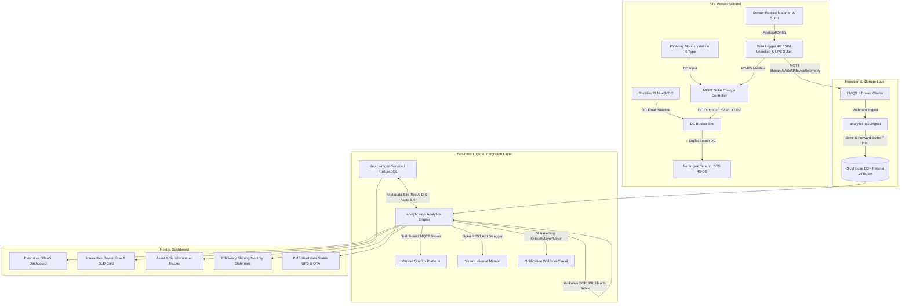

# Mitratel SPS On-Grid (GTaaS) Implementation Plan

> **For agentic workers:** REQUIRED SUB-SKILL: Use superpowers:subagent-driven-development to implement this plan task-by-task. Steps use checkbox (`- [ ]`) syntax for tracking.

**Goal:** Mengembangkan dan mengadaptasi platform IIoT Multi-Site menjadi sistem manajemen dan monitoring terintegrasi penuh untuk proyek **Solar Panel System (SPS) On-Grid** PT Dayamitra Telekomunikasi Tbk (Mitratel) skema **Green Tower as a Service (GTaaS)**, mencakup kalkulasi efisiensi sharing, pelacakan aset & nomor seri, integrasi Oneflux MQTT & Open API, health index PV/MPPT, SLA insiden, visualisasi Power Flow SLD, serta monitoring hardware PMS (UPS & OTA).

**Architecture:**
Platform IIoT diekstensikan dengan model domain telekomunikasi surya DC-Coupling (−48 VDC). Backend `device-mgmt` (Postgres) mencatat spesifikasi teknis site Tipe A–D, profil rectifier baseline, serta ketertelusuran nomor seri PV dan MPPT. Service `analytics-api` & ClickHouse mengolah data time-series beretensi minimal 24 bulan, menghitung Solar Contribution Ratio (SCR), Performance Ratio (PR), penghematan kWh PLN, serta PV/MPPT Health Index. Layanan Northbound MQTT Bridge dan Open REST API mengekspos data ke platform Oneflux Mitratel. Frontend Next.js diperkaya dengan Single Line Diagram (SLD) Power Flow real-time, dashboard eksekutif penghematan biaya/ESG, laporan bulanan efisiensi sharing, serta kartu status hardware PMS.

**Architecture Diagram:**



**Tech Stack:** 
- **Backend**: FastAPI (Python 3.11+), SQLAlchemy 2.0, PostgreSQL, ClickHouse (`clickhouse-connect`), Pydantic v2.
- **Broker & Network**: EMQX 5, MQTT v3.1.1/v5, Paho-MQTT client (Northbound bridge).
- **Frontend**: Next.js 16 (App Router), React 19, Tailwind CSS v4, Lucide React, Recharts / HTML5 Canvas / SVG untuk animasi arus daya.

**Spec:** Rencana Kerja dan Syarat (RKS) Teknis & Term of Reference (ToR) Pekerjaan Design & Build Solar Panel System (SPS) On-Grid Pada Site Menara Telekomunikasi PT Dayamitra Telekomunikasi Tbk (Mitratel) - No. Dokumen: RKS Teknis & ToR — SPS On-Grid | Mitratel (31 halaman).

---

## Global Constraints

- **Zero Breaking Changes (Prinsip Non-Destruktif)**: Kode, skema database, API endpoint, dan alur kerja yang sudah berjalan dan berhasil saat ini **TIDAK BOLEH DIUBAH ATAU DIRUSAK**. Seluruh penambahan fitur bersifat aditif (ekstensi) dan menjamin kompatibilitas mundur 100% (*100% backward compatible*).
- **Database Safety**: Semua penambahan kolom baru pada tabel PostgreSQL (`sites`, `devices`, dll.) wajib bersifat `nullable=True` atau memiliki nilai `default` yang aman, sehingga data dan query eksisting tetap berjalan normal tanpa error.
- **API & Telemetry Ingestion Compatibility**: Endpoint API lama (`/api/v1/sites`, `/api/v1/devices`, `/api/v1/telemetry`, `/api/v1/summary/*`) dan format topik MQTT eksisting (`t/{tenant}/...` serta format gateway Haiwell `data/...`) tetap beroperasi penuh tanpa ada breaking changes. Fitur SPS baru diekspos secara aditif.
- **UI Non-Destructive**: Halaman dan komponen dashboard yang sudah berfungsi (Device Status, Stat Card, Radial Gauge, Telemetry Table, Site Map) tetap dipertahankan, modul SPS (Power Flow, GTaaS KPI, Statement) ditambahkan secara harmonis sebagai tab/komponen pelengkap.
- **Multitenancy & Security**: Seluruh penamaan tabel dan relasi multitenant wajib membawa `tenant_id` / `tenant_slug` dengan isolasi data yang ketat.
- **Topologi SPS**: Topologi kelistrikan merefleksikan DC Coupling On-Grid (−48 VDC) tanpa baterai.
- **Retensi Data**: Retensi data operasional dan perhitungan penghematan minimal 24 bulan (730 hari) di ClickHouse.
- **Kepatuhan Mitratel**: Endpoint Open REST API untuk Mitratel harus terdokumentasi OpenAPI/Swagger dan terproteksi API Key / token.

---

## TAHAP 1: Domain & Data Modeling (PostgreSQL & ClickHouse)

### Task 1: Ekstensi Model Database PostgreSQL untuk Spesifikasi SPS & Aset

**Files:**
- Modify: `services/device-mgmt/app/models.py`
- Modify: `services/device-mgmt/app/schemas.py`
- Modify: `services/device-mgmt/app/routers/sites.py`
- Modify: `services/device-mgmt/app/routers/devices.py`
- Create: `services/device-mgmt/alembic/versions/002_sps_domain_and_assets.py`
- Test: `services/device-mgmt/tests/test_sps_models.py`

**Interfaces:**
- Consumes: Model `Site`, `Device`, `Tenant` yang sudah ada di [models.py](file:///e:/Project/iiot_multisite/services/device-mgmt/app/models.py).
- Produces: Properti konfigurasi SPS (`site_type` A/B/C/D, `pv_capacity_kwp`, `mppt_capacity_a`, `rectifier_float_voltage`, `baseline_kwh_daily`, `latitude`, `longitude`, `tower_type`) dan tabel `DeviceAsset` (serial number, tipe komponen PV/MPPT/Logger, tanggal instalasi, masa garansi).

- [x] **Step 1: Tulis unit test untuk model site SPS dan device asset**

```python
# services/device-mgmt/tests/test_sps_models.py
import pytest
from app.models import Site, Device, DeviceAsset, SiteConfigurationType

def test_sps_site_configuration(db_session, test_tenant):
    site = Site(
        tenant_id=test_tenant.id,
        slug="site-jkt-01",
        name="Site Jakarta 01",
        site_type=SiteConfigurationType.TYPE_A,
        pv_capacity_kwp=5.85,
        mppt_capacity_a=80.0,
        rectifier_float_voltage=53.5,
        baseline_kwh_daily=72.0,
        latitude=-6.2088,
        longitude=106.8456,
        tower_type="4 Legged 72M",
    )
    db_session.add(site)
    db_session.commit()
    assert site.site_type == SiteConfigurationType.TYPE_A
    assert site.pv_capacity_kwp == 5.85

def test_sps_device_asset_serial_tracking(db_session, test_site, test_tenant):
    device = Device(tenant_id=test_tenant.id, site_id=test_site.id, device_key="mppt-01", name="MPPT Unit 1")
    db_session.add(device)
    db_session.commit()
    
    asset = DeviceAsset(
        device_id=device.id,
        asset_type="mppt",
        brand="Huawei / Vertiv",
        model="MPPT 80A 250V",
        serial_number="SN-MPPT-2026-9988",
        warranty_years=2,
        is_spare=False
    )
    db_session.add(asset)
    db_session.commit()
    assert asset.serial_number == "SN-MPPT-2026-9988"
```

- [x] **Step 2: Jalankan test untuk memverifikasi kegagalan**

Run: `docker compose exec device-mgmt pytest tests/test_sps_models.py -v`
Expected: FAIL (AttributeError: 'Site' has no attribute 'site_type' / DeviceAsset not defined).

- [x] **Step 3: Implementasikan model SQLAlchemy dan schema Pydantic secara Non-Breaking**

Tambahkan `SiteConfigurationType` (TIPE_A: 3.0kW/5.85kWp/80A, TIPE_B: 4.5kW/8.2kWp/100A, TIPE_C: 6.0kW/11.7kWp/2x80A, TIPE_D: 7.5kW/14.0kWp/2x100A) dan tabel `DeviceAsset` ke [models.py](file:///e:/Project/iiot_multisite/services/device-mgmt/app/models.py). Semua kolom baru di `Site` diset `nullable=True` dengan nilai default yang aman sehingga data site eksisting yang sudah ada tetap utuh dan valid 100% tanpa breaking changes. Perbarui [schemas.py](file:///e:/Project/iiot_multisite/services/device-mgmt/app/schemas.py) untuk menyertakan field ini sebagai field opsional pada CRUD endpoint.

- [x] **Step 4: Buat dan jalankan migrasi Alembic**

Jalankan autogenerate migrasi di container `device-mgmt` dan upgrade database PostgreSQL.

- [x] **Step 5: Verifikasi test lulus dan commit**

Run: `docker compose exec device-mgmt pytest tests/test_sps_models.py -v`
Expected: PASS
Commit: `git commit -m "feat(device-mgmt): add SPS site configuration and asset serial tracking models"`

---

### Task 2: Peningkatan Skema ClickHouse (Retensi 24 Bulan & Agregasi Khusus Solar)

**Files:**
- Modify: `services/clickhouse/init/002-schema.sql`
- Create: `services/clickhouse/init/004-sps-energy-aggregations.sql`
- Test: `services/analytics-api/tests/test_clickhouse_sps_schema.py`

**Interfaces:**
- Consumes: Skema tabel `telemetry`, `telemetry_agg_1m`, `telemetry_agg_1h`.
- Produces: Tabel `sps_daily_energy` (agregasi harian Solar kWh, Grid/Rectifier kWh, Load kWh, Solar Contribution Ratio) dengan TTL 2 tahun (24 bulan) untuk keperluan audit penagihan / efficiency sharing.

- [x] **Step 1: Tulis test validasi TTL dan tabel agregasi harian ClickHouse**

```python
# services/analytics-api/tests/test_clickhouse_sps_schema.py
def test_sps_daily_energy_table_exists(clickhouse_client):
    tables = clickhouse_client.command("SHOW TABLES LIKE 'sps_daily_energy'")
    assert "sps_daily_energy" in tables
```

- [x] **Step 2: Update TTL dan tambahkan materialized view agregasi harian SPS**

Ubah TTL tabel `telemetry` dari 180 hari menjadi 730 hari untuk metrik kunci, dan buat tabel:
```sql
CREATE TABLE IF NOT EXISTS sps_daily_energy
(
    tenant_slug LowCardinality(String),
    site_slug   LowCardinality(String),
    date        Date,
    solar_kwh   Float64,
    grid_kwh    Float64,
    load_kwh    Float64,
    solar_contribution_pct Float64,
    performance_ratio_pct  Float64,
    updated_at  DateTime DEFAULT now()
)
ENGINE = ReplacingMergeTree(updated_at)
PARTITION BY toYYYYMM(date)
ORDER BY (tenant_slug, site_slug, date)
TTL date + INTERVAL 2 YEAR;
```

- [x] **Step 3: Eksekusi SQL migrasi ke ClickHouse dan verifikasi test**

Run: `docker compose exec analytics-api pytest tests/test_clickhouse_sps_schema.py -v`
Expected: PASS
Commit: `git commit -m "feat(clickhouse): add 24-month retention and sps_daily_energy table"`

---

## TAHAP 2: Ingestion & Engine Kalkulasi GTaaS (Analytics API)

### Task 3: Standardisasi Kamus Metrik SPS & Penanganan Store-and-Forward Buffering

**Files:**
- Modify: `services/analytics-api/app/ingest_logic.py`
- Modify: `services/analytics-api/app/topics.py`
- Test: `services/analytics-api/tests/test_sps_ingest.py`

**Interfaces:**
- Consumes: Payload MQTT dari Data Logger 4G (Modbus RTU ke MPPT dan Sensor).
- Produces: Ekstraksi metrik terstandardisasi: `v_pv`, `i_pv`, `p_pv`, `v_mppt_out`, `i_mppt_out`, `p_mppt_out`, `v_busbar`, `i_rectifier`, `p_rectifier`, `irradiance`, `temp_mppt`.

- [x] **Step 1: Tulis unit test untuk parsing payload SPS lengkap dan data buffering**

```python
# services/analytics-api/tests/test_sps_ingest.py
from datetime import datetime, timezone, timedelta
from app.ingest_logic import extract_numeric_metrics, resolve_timestamp

def test_sps_payload_metric_extraction():
    payload = {
        "ts": 1774435200,
        "irradiance": 850.5,
        "v_pv_string1": 185.4,
        "i_pv_string1": 16.2,
        "v_mppt_out": 54.2,
        "i_mppt_out": 52.8,
        "p_mppt_out": 2861.76,
        "temp_mppt": 42.5,
        "v_busbar": 53.6,
        "i_rectifier": 12.1
    }
    metrics = dict(extract_numeric_metrics(payload))
    assert metrics["irradiance"] == 850.5
    assert metrics["v_mppt_out"] == 54.2
    assert metrics["temp_mppt"] == 42.5

def test_store_and_forward_timestamp_preservation():
    # Simulasi data buffering 3 hari lalu
    past_time = datetime.now(timezone.utc) - timedelta(days=3)
    epoch_past = int(past_time.timestamp())
    resolved = resolve_timestamp({"ts": epoch_past}, publish_received_at=int(datetime.now(timezone.utc).timestamp() * 1000))
    assert abs((resolved - past_time).total_seconds()) < 2
```

- [x] **Step 2: Verifikasi test dan pastikan backward compatibility tetap terjaga**

Run: `docker compose exec analytics-api pytest tests/test_sps_ingest.py -v`

- [x] **Step 3: Update `ingest_logic.py` dan validasi**

Commit: `git commit -m "feat(analytics-api): support standard SPS metrics and buffered timestamps"`

---

### Task 4: GTaaS Calculation Engine (SCR, PR, Health Index, String Anomaly)

**Files:**
- Create: `services/analytics-api/app/sps_engine.py`
- Create: `services/analytics-api/app/routers/sps_analytics.py`
- Modify: `services/analytics-api/app/main.py`
- Test: `services/analytics-api/tests/test_sps_engine.py`

**Interfaces:**
- Consumes: Data time-series dari ClickHouse dan parameter kapasitas dari `device-mgmt`.
- Produces: API endpoint `/api/sps/sites/{site_slug}/performance` dan `/api/sps/sites/{site_slug}/health`.

- [x] **Step 1: Tulis unit test untuk rumus kalkulasi GTaaS**

```python
# services/analytics-api/tests/test_sps_engine.py
from app.sps_engine import calculate_solar_contribution, calculate_performance_ratio, detect_string_anomaly

def test_solar_contribution_ratio():
    solar_kwh = 35.0
    total_load_kwh = 70.0
    scr = calculate_solar_contribution(solar_kwh=solar_kwh, total_load_kwh=total_load_kwh)
    assert scr == 50.0  # 50% beban disuplai surya

def test_string_anomaly_detection():
    # RKS 2.4.2 butir A2: Deviasi antar string > 5% dianggap anomali
    strings = [16.0, 16.2, 14.5] # string 3 drop > 5%
    is_anomaly, max_dev = detect_string_anomaly(strings)
    assert is_anomaly is True
    assert max_dev > 5.0
```

- [x] **Step 2: Implementasikan `sps_engine.py` dan endpoint API**

Tambahkan fungsi penghitungan Solar Contribution Ratio (SCR), Performance Ratio (PR), PV Health (perbandingan iradiasi sensor vs kWh aktual), dan MPPT Health (efisiensi konversi > 97%, temperatur < 70°C).

- [x] **Step 3: Jalankan test dan commit**

Run: `docker compose exec analytics-api pytest tests/test_sps_engine.py -v`
Expected: PASS
Commit: `git commit -m "feat(analytics-api): add GTaaS calculation engine for SCR, PR and health index"`

---

## TAHAP 3: Integrasi Eksternal (Oneflux MQTT Bridge & Open API)

### Task 5: Open RESTful API Terstandarisasi untuk Penarikan Data Mandiri Mitratel

**Files:**
- Create: `services/analytics-api/app/routers/open_api.py`
- Create: `services/analytics-api/app/open_api_auth.py`
- Modify: `services/analytics-api/app/main.py`
- Test: `services/analytics-api/tests/test_open_api.py`

**Interfaces:**
- Consumes: API Key header `X-Mitratel-API-Key`.
- Produces: Endpoint publik `/api/v1/external/sites/{site_slug}/metrics` dengan OpenAPI documentation compliant terhadap spesifikasi RKS 2.3.3.c butir 5.

- [ ] **Step 1: Tulis test pengujian API Key dan output skema JSON terbuka**

```python
# services/analytics-api/tests/test_open_api.py
def test_open_api_unauthorized(client):
    res = client.get("/api/v1/external/sites/site-jkt-01/metrics")
    assert res.status_code == 401

def test_open_api_authorized(client, valid_api_key):
    res = client.get("/api/v1/external/sites/site-jkt-01/metrics", headers={"X-Mitratel-API-Key": valid_api_key})
    assert res.status_code == 200
    assert "solar_contribution_pct" in res.json()
```

- [ ] **Step 2: Implementasi autentikasi API Key dan endpoint OpenAPI**

- [ ] **Step 3: Verifikasi test dan commit**

Run: `docker compose exec analytics-api pytest tests/test_open_api.py -v`
Commit: `git commit -m "feat(analytics-api): add Open RESTful API with API Key auth for Mitratel"`

---

### Task 6: Northbound MQTT Bridge ke Platform Oneflux Mitratel

**Files:**
- Create: `services/analytics-api/app/oneflux_bridge.py`
- Modify: `services/analytics-api/app/config.py`
- Test: `services/analytics-api/tests/test_oneflux_bridge.py`

**Interfaces:**
- Consumes: Pesan telemetry yang baru saja di-ingest.
- Produces: Publish berkala (interval 5 menit) ke broker eksternal Oneflux Mitratel dengan topik `mitratel/gtaas/{tenant_slug}/{site_slug}/telemetry`.

- [ ] **Step 1: Tulis mock test untuk publikasi pesan ke broker Oneflux**

- [ ] **Step 2: Implementasikan worker thread / task asinkron MQTT client**

- [ ] **Step 3: Verifikasi test dan commit**

Commit: `git commit -m "feat(analytics-api): add Northbound MQTT publisher for Oneflux integration"`

---

## TAHAP 4: Manajemen Alarm, SLA & Incident Report

### Task 7: Engine Evaluasi SLA (Kritikal ≤4h, Mayor ≤8h, Minor ≤24h) & Tiket Insiden

**Files:**
- Create: `services/device-mgmt/app/models_incident.py`
- Create: `services/analytics-api/app/alert_evaluator.py`
- Modify: `services/analytics-api/app/main.py`
- Test: `services/analytics-api/tests/test_alert_evaluator.py`

**Interfaces:**
- Consumes: Data telemetry real-time dan status konektivitas device.
- Produces: Pembuatan insiden otomatis (Critical: SPS mati total / tenant drop; Mayor: produksi drop > 30% / string offline / PMS hilang; Minor: anomali ringan < 30%) beserta timer countdown SLA response & restoration.

- [ ] **Step 1: Tulis test logika klasifikasi alarm sesuai RKS 2.5.4**

```python
# services/analytics-api/tests/test_alert_evaluator.py
from app.alert_evaluator import classify_severity

def test_classify_critical():
    # SPS mati total di siang bolong (irradiance > 500 tapi p_mppt == 0)
    sev = classify_severity(irradiance=600.0, p_mppt=0.0, is_offline=False)
    assert sev == "CRITICAL"  # Response <= 4h, Restoration <= 24h

def test_classify_major_production_drop():
    # Produksi drop > 30% dari potensi teoritis
    sev = classify_severity(irradiance=800.0, p_mppt=1500.0, theoretical_p=4000.0, is_offline=False)
    assert sev == "MAYOR"  # Response <= 8h, Restoration <= 3x24h
```

- [ ] **Step 2: Implementasi evaluator alarm dan pengiriman webhook/email**

- [x] **Step 3: Jalankan test dan commit**

Commit: `git commit -m "feat(alerts): add SLA-based alarm classification and incident tracking engine"`

---

## TAHAP 5: Peningkatan UI / Frontend (Power Flow, KPI & Laporan)

### Task 8: Interactive Power Flow & Single Line Diagram (SLD) Card

**Files:**
- Create: `services/frontend/components/sps/power-flow-card.tsx`
- Create: `services/frontend/components/sps/single-line-diagram-modal.tsx`
- Modify: `services/frontend/app/(dashboard)/(homes)/dashboard/page.tsx`
- Test: Visual & component test di browser.

**Interfaces:**
- Consumes: Data telemetry terkini: `p_pv`, `v_mppt_out`, `i_mppt_out`, `v_busbar`, `p_rectifier`, `p_load`.
- Produces: Kartu diagram interaktif dengan animasi aliran listrik DC:
  - Partikel daya mengalir dari **Solar PV** $\rightarrow$ **MPPT** $\rightarrow$ **DC Busbar**.
  - Aliran listrik dari **Rectifier PLN** $\rightarrow$ **DC Busbar**.
  - Aliran listrik gabungan $\rightarrow$ **Perangkat Tenant (BTS Menara)**.
  - Indikator status voltase: delta tegangan MPPT vs Float Rectifier (memastikan selisih +0.5V s/d +1.0V terpenuhi untuk pembagian beban otomatis).

- [ ] **Step 1: Buat komponen SVG/Canvas Power Flow dengan animasi CSS pulses**

- [ ] **Step 2: Hubungkan data real-time dari endpoint `/api/sps/sites/{site}/performance`**

- [ ] **Step 3: Integrasikan ke halaman dashboard utama**

- [ ] **Step 4: Commit**

Commit: `git commit -m "feat(frontend): add interactive SPS Power Flow diagram card to dashboard"`

---

### Task 9: Executive GTaaS Dashboard & Widget Penghematan Biaya/ESG

**Files:**
- Create: `services/frontend/components/sps/gtaas-summary-cards.tsx`
- Modify: `services/frontend/app/(dashboard)/(homes)/dashboard/components/stat-card.tsx`

**Interfaces:**
- Consumes: Metrik agregasi harian dan bulanan dari ClickHouse via BFF.
- Produces: 4 Kartu KPI Utama:
  1. **Solar Energy Generated (kWh)** (Hari ini & Bulan ini).
  2. **PLN kWh Saved & Cost Avoided (Rp)** (menggunakan tarif listrik PLN B3/I3 per kWh).
  3. **Solar Contribution Ratio (%)** (Persentase beban yang ditopang surya).
  4. **ESG Carbon Avoidance (kg $CO_2e$)** (berdasarkan formula emisi jaringan Jawa-Madura-Bali / Luar Jawa).

- [ ] **Step 1: Buat komponen kartu KPI GTaaS dengan visual modern & gradient cards**

- [ ] **Step 2: Hubungkan kartu KPI ke data agregasi riil**

- [ ] **Step 3: Commit**

Commit: `git commit -m "feat(frontend): add GTaaS executive KPI cards for energy, cost and ESG"`

---

### Task 10: Modul Laporan Penagihan & Efficiency Sharing Statement

**Files:**
- Create: `services/frontend/app/(dashboard)/reports/efficiency-sharing/page.tsx`
- Create: `services/frontend/components/reports/billing-statement-table.tsx`
- Modify: `services/frontend/components/sidebar-data.ts` (tambahkan menu "Efficiency Sharing")

**Interfaces:**
- Consumes: Endpoint agregasi harian `sps_daily_energy` untuk rentang bulan yang dipilih.
- Produces: Lembar audit penagihan bulanan resmi (reconciliation statement) yang merinci:
  - Tanggal, kWh Produksi Surya, kWh Suplai Rectifier, Total kWh Konsumsi Tenant.
  - Solar Contribution Ratio harian.
  - Nilai penghematan tarif PLN & rasio bagi hasil (*efficiency sharing*).
  - Tombol Ekspor ke Excel (.xlsx) dan PDF siap cetak untuk lampiran tagihan tenant operator.

- [ ] **Step 1: Buat halaman laporan dan tabel data harian**

- [ ] **Step 2: Tambahkan fungsi ekspor CSV/Excel dan format print PDF**

- [ ] **Step 3: Tambahkan item menu di sidebar**

- [ ] **Step 4: Commit**

Commit: `git commit -m "feat(frontend): add monthly efficiency sharing statement and export page"`

---

## TAHAP 6: Monitoring Hardware PMS

### Task 11: Monitoring Hardware PMS, UPS Internal 3 Jam & Remote OTA (RKS 2.3.3.c)

**Files:**
- Modify: `services/analytics-api/app/ingest_logic.py`
- Modify: `services/frontend/app/(dashboard)/(homes)/dashboard/components/device-status-card.tsx`
- Create: `services/frontend/components/sps/pms-hardware-status-card.tsx`

**Interfaces:**
- Consumes: Status internal dari data logger (level tegangan baterai backup UPS, status catu daya 48VDC, versi firmware data logger, status konektivitas 4G/LTE signal strength).
- Produces: Kartu diagnostik keandalan perangkat monitoring:
  - Indikator status daya cadangan **UPS Internal PMS (minimal 3 jam operasi)** saat catu daya utama terputus.
  - Status koneksi data 4G/LTE (operator seluler, RSSI / RSRP signal strength).
  - Indikator status **Over The Air (OTA)** update firmware remote tanpa perlu hadir ke lokasi site.
  - Alarm jika logger beralih ke baterai internal atau kapasitas baterai backup rendah.

- [ ] **Step 1: Tambahkan ekstraksi metrik internal PMS (`pms_batt_voltage`, `pms_power_source`, `pms_fw_version`, `pms_signal_rssi`)**

- [ ] **Step 2: Buat komponen UI hardware status diagnostik pada frontend**

- [ ] **Step 3: Commit**

Commit: `git commit -m "feat(monitoring): add PMS hardware UPS backup and OTA firmware tracking"`

---

## Rangkuman Deliverable

Plan ini mencakup Task 1 s/d Task 11. Modul Digital ATP, Sparepart, Legalitas NIDI/SLO, dan Digital Survey 7 Tahap **tidak termasuk** dalam lingkup plan ini (dihapus per revisi).

| Bab / Pasal RKS | Topik | Task Implementasi di Plan |
| :--- | :--- | :--- |
| **Pasal 2.1.1** | Konfigurasi DC Coupling On-Grid (-48 VDC), MPPT voltage +0.5V, proteksi reverse current | Task 1, 3, 4, 8 |
| **Pasal 2.1.2** | 4 Konfigurasi Sizing Tipe A-D | Task 1 |
| **Pasal 2.3.1** | PV Module, serial number tracking | Task 1 |
| **Pasal 2.3.2** | MPPT Solar Controller, Modbus | Task 1, 3, 4 |
| **Pasal 2.3.3.a** | Parameter Performansi (Iradiasi, V/I PV, Daya, kWh, SCR, PR, Efisiensi) | Task 2, 3, 4, 9 |
| **Pasal 2.3.3.b** | Parameter Kesehatan (PV Health & MPPT Health) | Task 4, 7, 9 |
| **Pasal 2.3.3.c** | MQTT Oneflux, 4G, retensi 24 bln, buffer 7 hari, Open API, UPS 3 jam, OTA | Task 2, 3, 5, 6, 10, 11 |
| **Pasal 2.4.1 & 2.4.2** | Verifikasi operasi & visualisasi power flow | Task 8 |
| **Pasal 2.6** | SLA Tiket Insiden | Task 7 |

